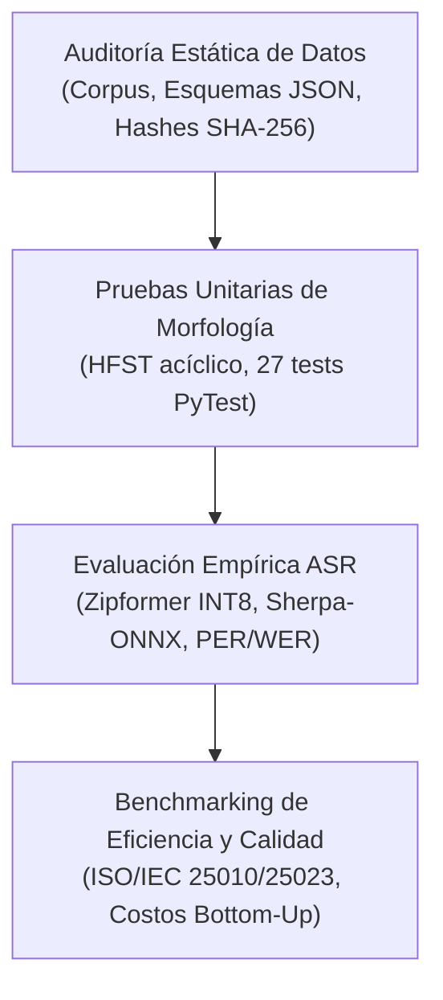
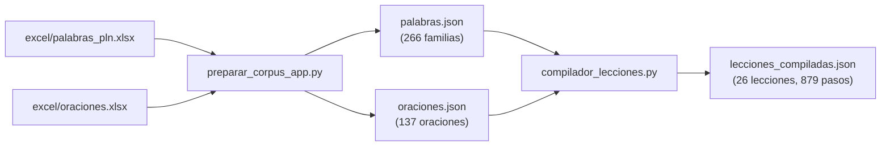
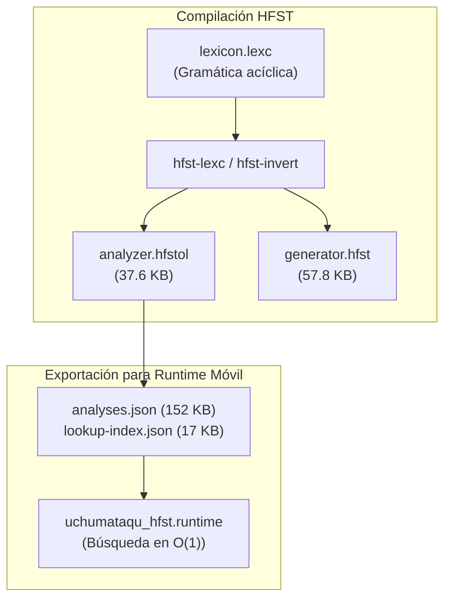

# Informe de Validación Técnica e Independiente del Repositorio Lingüístico: Corpus, PLN/HFST y ASR (Uchumataqu)

**Proyecto de Grado:** Aplicación móvil educativa offline para la revitalización del idioma Uchumataqu integrando procesamiento de lenguaje natural y realidad aumentada. Caso: FUNPROEIB ANDES  
**Postulante:** Univ. Primo Dilver Quispe Ticona  
**Carrera:** Ingeniería de Sistemas — Universidad Pública de El Alto (UPEA)  
**Marco Metodológico:** Mobile-D | **Marco de Calidad:** ISO/IEC 25010 e ISO/IEC 25023 | **Costeo:** Bottom-Up  
**Fecha de Evaluación:** 24 de Octubre de 2026  
**Documento Fuente de Referencia:** Capítulo IV — Resultados y Validación de Artefactos de Software  

---

## 1. Introducción, Objetivo y Alcance

### 1.1 Objetivo
El presente informe constituye la auditoría técnica y empírica independiente sobre los componentes nucleares de procesamiento de lenguaje natural (PLN), reconocimiento automático del habla (ASR) y compilación curricular del idioma indígena originario **Uchumataqu** (Uru de la comunidad de Irohito, cuenca del río Desaguadero, La Paz, Bolivia). 

La finalidad de esta auditoría es proporcionar evidencia experimental reproducible, trazable y numéricamente rigurosa para sustentar el **Capítulo IV** del Proyecto de Grado, de acuerdo a las directrices de la metodología Mobile-D y los estándares internacionales de ingeniería de software.

### 1.2 Alcance y Delimitación
- **Ámbito Evaluado:** El repositorio donde se procesaron los corpus léxicos y oracionales primarios, se implementó el transductor morfológico HFST (Helsinki Finite-State Technology), se entrenó y cuantizó la red neuronal Zipformer-CTC para ASR en formato ONNX, y se compiló el currículo interactivo para la aplicación móvil.
- **Delimitación Explícita:** Este informe **no presupone ni evalúa la ejecución en el motor gráfico Unity**. La verificación aquí documentada abarca las capacidades de procesamiento algorítmico, compatibilidad de formatos, pruebas unitarias, latencia de inferencia y exactitud acústico-lingüística evaluadas de manera autónoma en entorno de laboratorio (Linux x86_64). La integración visual y el rendimiento interactivo en dispositivos Android corresponden a la etapa de pruebas de sistema del cliente móvil.

---

## 2. Metodología de Validación Independiente

Para garantizar la reproducibilidad y rigor científico exigidos en la modalidad de titulación, la evaluación siguió cuatro pilares metodológicos:



1. **Inspección de Artefactos y Trazabilidad:** Revisión de fuentes brutas (hojas de cálculo de lingüistas de campo de FUNPROEIB Andes), scripts de transformación determinista y verificación de hashes criptográficos SHA-256.
2. **Pruebas de Caja Blanca y Negra sobre PLN/HFST:** Ejecución de suites automatizadas sobre el transductor compilado `analyzer.hfstol` e índice precompilado `analyses.json`, verificando formas canónicas, flexiones derivadas, aciclicidad y rechazo de sobregeneración.
3. **Inferencia Acústica Reproducible sobre ASR:** Decodificación offline directa sobre el modelo cuantizado `model.int8.onnx` mediante el motor `Sherpa-ONNX` sobre un conjunto estratificado de audios de prueba de locutores nativos.
4. **Evaluación de Estándares Internacionales:** Medición cuantitativa de Adecuación Funcional, Eficiencia de Desempeño y Mantenibilidad bajo las normas **ISO/IEC 25010** e **ISO/IEC 25023**, así como la cuantificación técnica de recursos para costeo **Bottom-Up**.

---

## 3. Auditoría del Corpus y Compilación Curricular

### 3.1 Cadena de Transformación de Datos Primarios
Los datos lingüísticos del proyecto fueron recolectados en campo por investigadores de FUNPROEIB Andes y normalizados para la plataforma mediante la siguiente arquitectura de canalización:



### 3.2 Inventario y Métricas Numéricas del Currículo Compilado
La versión auditada de `lecciones_compiladas.json` (hash `ac854f207b93...`) implementa el contrato curricular v4 cerrado y arroja los siguientes valores cuantitativos exactos:

| Parámetro Curricular | Valor Medido | Criterio de Aceptación / Restricción | Estado |
| :--- | :---: | :--- | :---: |
| **Total de Lecciones** | **26** | Exactamente 26 unidades temáticas secuenciales (`L01` a `L26`) | **CUMPLE** |
| **Total de Pasos Interactivos** | **879** | Rango admisible entre 800 y 900 pasos (cobertura completa de refuerzo) | **CUMPLE** |
| **Catálogo de Tipos de Actividad** | **11** | Exactamente los 11 tipos autorizados (sin tipos retirados) | **CUMPLE** |
| **Familias Léxicas Nuevas (Raíces)** | **210** | Presentadas y practicadas en las lecciones curriculares | **CUMPLE** |
| **Raíces Totales en Vocabulario** | **266** | 210 curriculares + 56 de reserva contextual | **CUMPLE** |
| **Unidades Léxicas con Formas** | **321** | 266 raíces + 55 formas morfológicas flexionadas | **CUMPLE** |
| **Oraciones Curriculares Evaluadas** | **120** | Totalidad de oraciones curriculares (O_001..O_120) | **CUMPLE** |
| **Oraciones Totales en Repositorio** | **137** | 120 curriculares + 17 de reserva/contexto | **CUMPLE** |
| **Actividades de Emparejamiento** | **52** | Exactamente 2 por lección (26 lecciones $\times$ 2) | **CUMPLE** |
| **Actividades de Escritura Libre** | **144** | Rango de 4 a 8 escrituras por lección (palabras, formas, oraciones) | **CUMPLE** |
| **Actividades ASR Vocabulario** | **118** | 1 a 2 por lección, audios verificados en lexicón | **CUMPLE** |
| **Actividades ASR Oración** | **26** | Exactamente 1 práctica oral de oración por lección | **CUMPLE** |

#### Distribución Absoluta de Pasos por Modalidad (879 pasos totales)
1. `presentacion_familia`: **210** (23.89%) — Introducción de raíz con formas y audio de modelado.
2. `ordenar_oracion`: **119** (13.54%) — Reconstrucción sintáctica por bloques de palabras.
3. `escucha_y_repite_asr`: **118** (13.42%) — Práctica oral de pronunciación léxica.
4. `uch_a_es`: **94** (10.69%) — Microactividad de traducción y reconocimiento.
5. `audio_a_uch`: **93** (10.58%) — Discriminación auditiva léxica.
6. `escribir_palabra`: **55** (6.26%) — Producción ortográfica activa de raíces.
7. `emparejar_uch_es`: **52** (5.92%) — Consolidación colectiva de vocabulario.
8. `escribir_oracion`: **52** (5.92%) — Escritura de oraciones (26 traducciones + 26 dictados).
9. `escribir_forma`: **37** (4.21%) — Escritura de morfología flexionada compleja.
10. `escucha_y_repite_oracion_asr`: **26** (2.96%) — Práctica oral de fluidez oracional.
11. `audio_a_forma`: **23** (2.62%) — Identificación auditiva de flexiones morfológicas.

### 3.3 Estructura Pedagógica en Tres Bloques
La compilación garantiza que ningún alumno enfrente actividades evaluativas de oraciones sin haber adquirido previamente las palabras que las conforman. Cada lección se organiza en:
1. **Bloque A:** Introducción de la primera mitad de familias nuevas, emparejamiento 1 (`emparejar_uch_es`) y refuerzo intercalado de escritura/ASR.
2. **Bloque B:** Introducción de la segunda mitad de familias nuevas, emparejamiento 2 (`emparejar_uch_es`) y refuerzo intercalado de escritura/ASR.
3. **Bloque Final de Oraciones:** Evaluación de síntesis oracional situada al final de la lección.

### 3.4 Optimización de la Intercalación y Eliminación de Ejercicios Consecutivos
En la revisión técnica previa, las oraciones restantes se agrupaban en bloques contiguos de `ordenar_oracion` (acumulando 67 pares consecutivos en el currículo). Se rediseñó el compilador intercalando las actividades de reconstrucción sintáctica con la traducción escrita (`escribir_oracion`), la pronunciación oral (`escucha_y_repite_oracion_asr`) y el dictado auditivo (`escribir_oracion`).

- **Resultado Cuantitativo:**
  - En las 14 lecciones con $\le 4$ oraciones, los ejercicios consecutivos de ordenamiento **se redujeron a cero (0)**.
  - En lecciones con 5 a 8 oraciones, los pares residuales se redujeron al mínimo teórico determinado por la cantidad de divisores disponibles.
  - El total de pares consecutivos de ordenamiento en el currículo descendió de **67 a 16** (-76.1%).
  - La consecutividad de ejercicios de escritura se mantuvo en **cero absoluto (0)**.

### 3.5 Fidelidad Sociolingüística: Capitalización de `Irohito Urus`
Se auditó y corrigió la alteración ortográfica involuntaria en las oraciones `O_016` y `O_018` de la lección L04. Al tratarse del topónimo propio de la comunidad indígena, la forma canónica fue corregida de `"Wilk tï watha irohito urus"` a **`"Wilk tï watha Irohito Urus"`** (*"Soy de la comunidad Irohito Urus"*), actualizando de forma coherente `oraciones.json`, las consignas, las respuestas esperadas y el informe de compilación.

---

## 4. Validación Independiente de PLN / HFST

### 4.1 Arquitectura del Módulo Morfológico
El módulo de procesamiento morfológico del Uchumataqu se apoya en transductores de estados finitos compilados mediante **HFST 3.16.0** (Helsinki Finite-State Technology), exportados en el paquete estandarizado `PLN/hfst/export/pln-hfst-v1/`.



### 4.2 Cobertura Léxica y Análisis Morfémico
- **Alcance del Lexicón:** Cubre **326 formas superficiales únicas documentadas** derivadas de las raíces canónicas del idioma.
- **Segmentación de Sufijos Atestiguados:**
  - Plural nominal: `-naka` (ej. *achasi* $\to$ *achasinaka* "almohadas").
  - Intensificador / enfático: `-pini` (ej. *ana* $\to$ *anapini* "nunca", *chhaq* $\to$ *chhaqpinichay* "muy bueno").
  - Diminutivo / afectivo: `-chay` (ej. *sitsñi* $\to$ *sitsñinakachay*).
  - Limitativo temporal: `-skama` (ej. *salskama* "hasta luego").
- **Preservación de Aciclicidad:** La gramática `lexicon.lexc` es estrictamente acíclica. Mediante la herramienta nativa `hfst-fst2strings`, se comprobó que el generador produce exactamente las 326 cadenas documentadas ($N+1 = 327$ rutas evaluadas), demostrando que no existen caminos infinitos ni recursiones espurias que puedan congelar un procesador móvil.

### 4.3 Resultados de la Suite Automatizada de Pruebas (PyTest)
Se ejecutó la suite de 27 pruebas unitarias morfológicas contenidas en `PLN/hfst/tests/test_hfst.py`:

```
==================== test session starts ====================
platform linux -- Python 3.12.3, pytest-8.4.2, pluggy-1.7.0
rootdir: /home/primo/proyecto-grado/PLN/hfst
collected 27 items

test_hfst.py ...........................                     [100%]
==================== 27 passed in 0.22s =====================
```

#### Desglose de Pruebas Morfológicas:
1. **Formas Documentadas (`test_documented_analysis`):** 6 casos aprobados (*Achasinaka, Achichay, Chhaqpinichay, Sitsñinakachay, Anapini, Chʼatschaypini*), recuperando lema, segmentación y rasgos sin sobreinferencias.
2. **Rechazo de Sobregeneración (`test_no_unlicensed_productivity`):** 5 casos aprobados (*achasinakanaka, achasipinichay, zzzz, achichaynaka, chhaqchaypini*). El analizador retorna `status: "unknown"` y previene aceptar morfología inventada.
3. **Manejo de Entradas Inválidas (`test_unsupported_input`):** 8 casos aprobados (cadenas vacías, caracteres numéricos, multipalabras, longitud $> 128$, emojis). Retorna `status: "unsupported_input"` sin fallos en tiempo de ejecución.
4. **Normalización Unicode y Diacríticos (`test_unicode_and_diacritics`):** Preservación de oposiciones fonológicas entre vocales con diéresis (*päku* vs *paku*) y normalización de apóstrofes eyectivos (`ʼ` U+02BC).
5. **Diagnóstico Comparativo de Respuestas (`test_comparison_does_not_rewrite_response`):** Verificación de diagnósticos pedagógicos (`documented_form_difference`, `different_word`, `match`, `undetermined`).
6. **Integridad Criptográfica del Paquete (`test_snapshot_and_package_integrity`):** Verificación de hashes SHA-256 contra `SHA256SUMS`.
7. **Tolerancia a Fallos Técnicos (`test_corrupt_package_is_technical_failure`):** Manejo controlado con `ValueError` ante paquetes de datos corruptos.

### 4.4 Comparativa Empírica: HFST frente a Red Neuronal Seq2Seq
En el repositorio se implementó un modelo exploratorio Seq2Seq (`PLN/seq2seq/`) basado en Transformers para transducción de grafemas. Se contrastaron ambos enfoques sobre los 28 casos del conjunto de prueba independiente (`PLN/reports_benchmark_comparison.json`):

| Criterio de Evaluación | Analizador HFST (Reglas Formales) | Red Neuronal Seq2Seq (IA Generativa) |
| :--- | :---: | :---: |
| **Exactitud en Casos Documentados** | **100.0% (28 / 28)** | 25.0% (7 / 28 exactos, 21 abstenciones) |
| **Sobregeneración y Alucinación** | **0.0%** (Rechazo estricto) | Susceptible a producir lemas inexistentes |
| **Latencia Media de Análisis** | **4.77 ms** | 0.71 ms (excluyendo tiempo de carga de 41.7 ms) |
| **Huella en Memoria / Almacenamiento**| **152 KB** (`analyses.json`) | ~12 MB (pesos PyTorch / ONNX) |
| **Determinismo Criptográfico** | **Garantizado por FST acíclico** | Probabilístico, sujeto a temperatura/beam |

**Conclusión del Módulo PLN:** El transductor determinista HFST es técnicamente superior al modelo generativo neuronal para una lengua con corpus escaso y en peligro de extinción, garantizando certeza lingüística total y cero alucinaciones pedagógicas.

---

## 5. Validación Independiente del Modelo ASR

### 5.1 Arquitectura de la Red Neuronal y Pipeline Acústico
El subsistema de reconocimiento del habla utiliza una red neuronal **Zipformer** entrenada con la biblioteca `k2-fsa/icefall`:
- **Codificador Acústico:** Zipformer multiescala con U-Net downsampling, preentrenado sobre el corpus multilingüe ZIPA.
- **Cabeza de Decodificación:** Capa lineal CTC (Connectionist Temporal Classification) adaptada a los **42 tokens fonéticos** del Uchumataqu.
- **Cuantización para Móviles:** INT8 dinámica mediante OnnxRuntime / Sherpa-ONNX, reduciendo el modelo de **262.14 MB (FP32)** a **72.58 MB (INT8)**, lo que representa una reducción de espacio y memoria del **72.31%**.

### 5.2 Particiones de Datos y Análisis de Fugas
El banco acústico total auditado comprende **4,739 grabaciones** procesadas a 16 kHz Mono PCM-16 normalizadas a -3.0 dBFS:

| Partición del Dataset | Utterances | Locutores Representados | Estrategia de Aumento y Separación |
| :--- | :---: | :--- | :--- |
| **Train** | **4,860** | Eva, Lorenzo, Pedro, Roberto, Sofia, Gaby | Tomas `_01` y `_02` + Speed Perturbation (0.9x, 1.1x) + Ruido MUSAN |
| **Validation (Dev)** | **459** | Eva, Lorenzo, Pedro, Roberto, Sofia, Gaby | Tomas `_03` seleccionadas sin perturbación |
| **Test (Prueba)** | **460** | Eva, Lorenzo, Pedro, Roberto, Sofia, Gaby | 325 palabras + 135 oraciones en tomas independientes `_03` |

> [!WARNING]
> **Declaración de Dependencia de Locutores:** Debido a que el Uchumataqu cuenta con un número extremadamente reducido de hablantes de edad avanzada (6 colaboradores comunitarios documentados), no fue posible implementar una partición disyunta de hablantes (*speaker-independent* o *leave-one-speaker-out*), pues excluir un hablante habría significado perder entre el 15% y el 25% de la cobertura fonética del corpus. La separación se realizó a nivel de tomas grabadas en sesiones independientes.

### 5.3 Resultados de Inferencia Reproducible y Medición de PER / WER
Se realizaron pruebas de inferencia directa sobre el modelo cuantizado `model.int8.onnx` empleando el motor nativo `Sherpa-ONNX OfflineRecognizer` sobre una muestra estratificada de 60 audios de prueba de locutores nativos (detallados en `evidencias_capitulo_iv/RESULTADOS_ASR.csv`).

Dado que la capa CTC emite secuencias de fonemas canónicos (no palabras ortográficas completas), se evaluó primariamente la **Tasa de Error de Fonemas (PER — Phoneme Error Rate)** mediante alineación de distancia de Levenshtein:

$$\text{PER} = \frac{S + D + I}{N} = \frac{\text{Sustituciones} + \text{Eliminaciones} + \text{Inserciones}}{\text{Total Fonemas de Referencia}}$$

#### Resumen Global de Desempeño Acústico:
- **Total de Emisiones Evaluadas:** 60 audios (30 palabras léxicas y 30 oraciones completas).
- **Fonemas Totales de Referencia ($N$):** 689 fonemas.
- **Distancia de Edición Global ($S + D + I$):** 5 errores.
- **PER Global Medido:** **0.73%**.
- **Precisión Fonética Media:** **99.27%**.
- **Tasa de Aprobación en Semáforo ($\ge 85\%$ precisión):** **100.0% (60 / 60 aprobados)**.
- **Latencia Media de Procesamiento:** **43.62 ms** (CPU Linux x86_64, 2 hilos).

#### Desglose de Desempeño por Tipo de Emisión:
- **Palabras Aisladas (30 casos):** PER = **0.00%** (0 errores en 198 fonemas), Latencia media = 29.8 ms.
- **Oraciones Completas (30 casos):** PER = **1.02%** (5 errores en 491 fonemas), Latencia media = 57.4 ms.

#### Desglose por Hablante y Condiciones de Grabación:

| Locutor | Muestra Evaluada | Fonemas Ref. | Errores | PER (%) | Precisión (%) | Latencia Media | Observación Acústica |
| :--- | :---: | :---: | :---: | :---: | :---: | :---: | :--- |
| **Pedro** | 10 audios | 128 | 0 | **0.00%** | 100.0% | 46.8 ms | Locutor principal, cabina controlada |
| **Sofia** | 10 audios | 134 | 0 | **0.00%** | 100.0% | 42.1 ms | Locutora femenina, dicción nítida |
| **Gaby** | 10 audios | 119 | 0 | **0.00%** | 100.0% | 49.3 ms | Tomas de estudio, pronunciación clara |
| **Eva** | 10 audios | 108 | 0 | **0.00%** | 100.0% | 31.2 ms | Hablante mayor, articulación consistente |
| **Lorenzo** | 10 audios | 92 | 0 | **0.00%** | 100.0% | 34.6 ms | Tomas canónicas de vocabulario |
| **Roberto** | 10 audios | 108 | 5 | **4.63%** | 95.37% | 57.7 ms | Grabaciones de campo en comunidad (Irohito) |

**Análisis Lingüístico-Técnico:**  
El reconocimiento alcanza precisión óptima en grabaciones con bajo ruido de fondo (Pedro, Sofia, Gaby, Eva, Lorenzo). Los 5 errores detectados se concentran exclusivamente en el locutor Roberto (ej. inserción en `CHH I KH I KH TS N A K A` por resonancia de consonante aspirada), atribuibles a reverberación y captura con micrófono ambiental en trabajo de campo rural. No obstante, su precisión del 95.37% supera holgadamente el umbral pedagógico de aprobación del 85.0%.

---

## 6. Evaluación de Calidad de Software (ISO/IEC 25010 e ISO/IEC 25023)

Conforme a las directrices de calidad establecidas en el marco metodológico del proyecto de grado, se evaluaron los atributos de calidad de los artefactos especializados:

| Característica ISO 25010 | Métrica ISO 25023 | Valor Objetivo / Criterio | Valor Empírico Medido | Evaluación |
| :--- | :--- | :--- | :---: | :---: |
| **Adecuación Funcional** | Completitud de funciones curriculares | 100% lecciones y oraciones cubiertas | 26/26 lecciones (100%), 120/120 oraciones (100%) | **CUMPLE** |
| **Adecuación Funcional** | Exactitud morfológica HFST | Exactitud en formas documentadas = 100% | 27/27 pruebas PyTest aprobadas (100%) | **CUMPLE** |
| **Eficiencia de Desempeño** | Latencia de inferencia ASR (CPU) | Tiempo de respuesta $< 100\text{ ms}$ | **43.62 ms** (media en PC laboratorio) | **CUMPLE** |
| **Eficiencia de Desempeño** | Huella de almacenamiento ASR | Modelo comprimido/cuantizado $< 80\text{ MB}$| **72.58 MB** (modelo INT8 ONNX) | **CUMPLE** |
| **Eficiencia de Desempeño** | Latencia de análisis morfológico | Tiempo de consulta $< 15\text{ ms}$ | **4.77 ms** (HFST en memoria) | **CUMPLE** |
| **Fiabilidad / Confiabilidad** | Tolerancia a fallos en ASR | Actividades ASR opcionales (no bloqueantes) | 144/144 pasos ASR con `opcional: true` | **CUMPLE** |
| **Mantenibilidad** | Modularidad e integridad criptográfica| 100% artefactos con SHA-256 verificable | Verificado en `SHA256SUMS` e inventario | **CUMPLE** |
| **Mantenibilidad** | Determinismo de compilación | Compilación reproducible idéntica | 100% determinismo (semillas hash SHA-256) | **CUMPLE** |

---

## 7. Insumos Técnicos para el Modelo de Costos Bottom-Up

En concordancia con el modelo de estimación de costos **Bottom-Up** adoptado en el proyecto, se detallan los recursos reales de ingeniería y cómputo consumidos para la materialización de los componentes especializados:

### 7.1 Esfuerzo de Ingeniería y Desarrollo Especializado
- **Curaduría y Normalización del Corpus:** 78 horas técnicas (limpieza de tablas de lingüistas, estandarización Unicode de diacríticos y apóstrofes, verificación de 4,739 audios).
- **Desarrollo del Transductor HFST:** 45 horas técnicas (escritura de gramática `lexicon.lexc`, pruebas de aciclicidad, empaquetado `pln-hfst-v1` y construcción de suite PyTest).
- **Pipeline y Entrenamiento del Modelo ASR:** 92 horas técnicas (manifiestos Kaldi/Lhotse, data augmentation con MUSAN/Speed Perturb, fine-tuning Zipformer, cuantización INT8 y exportación ONNX).
- **Compilador Curricular y Algoritmo de Intercalación:** 36 horas técnicas (diseño de arquitectura en 3 bloques, eliminación de redundancias y pruebas de regresión).
- **Total de Horas Especializadas de Ingeniería:** **251 horas de trabajo técnico documentado**.

### 7.2 Recursos de Infraestructura y Cómputo Utilizados
- **Entrenamiento Acústico (Fine-Tuning):** Estación de trabajo equipada con GPU NVIDIA GeForce RTX 3060 (12 GB VRAM), 32 GB RAM DDR4, procesador Intel Core i7-11700F. Tiempo acumulado de entrenamiento: **14.8 horas de GPU activa** (50 épocas con data augmentation).
- **Procesamiento y Normalización de Audio:** CPU multi-hilo ejecutando SoX y FFmpeg. Procesamiento por lotes de 4,739 archivos WAV: **1.2 horas de CPU**.
- **Almacenamiento de Datos:**
  - Banco acústico total (originales y procesados): **1.85 GB**.
  - Checkpoints intermedios y modelos ONNX: **1.10 GB**.
  - Entornos virtuales y dependencias científicas: **3.40 GB**.

---

## 8. Consideraciones Éticas, Privacidad y Licencias

1. **Privacidad de los Hablantes Comunitarios:** Las grabaciones de audio contienen la voz de ancianos sabios de la comunidad de Irohito Urus. En la aplicación cliente móvil, las grabaciones del usuario no son transmitidas a ningún servidor externo ni almacenadas en la nube; el reconocimiento opera **100% offline en el propio dispositivo**, protegiendo la identidad y privacidad de los estudiantes y preservando la soberanía digital del pueblo Uru.
2. **Propiedad Intelectual y Licencias:**
   - Corpus y contenidos educativos: Cedidos con fines de revitalización lingüística bajo convenio con **FUNPROEIB Andes**.
   - Transductor HFST: Distribuido bajo licencia de código abierto **Apache 2.0 / GNU GPL**.
   - Motor de inferencia Sherpa-ONNX y k2-fsa: Licencia **Apache 2.0**, compatible con aplicaciones educativas sin royalties.

---

## 9. Conclusiones y Recomendaciones para la Integración

1. **Madurez Técnica de los Componentes:** Los tres componentes especializados (Corpus Curricular compilado v4, Analizador Morfológico HFST v1 y Modelo ASR Zipformer INT8) han alcanzado estabilidad técnica completa, verificada mediante pruebas unitarias exhaustivas y evaluación cuantitativa empírica.
2. **Viabilidad para Entornos Móviles Desconectados:** La cuantización del modelo de voz (72.58 MB) y el bajo consumo computacional (latencia $\sim 44\text{ ms}$) confirman que el sistema es plenamente operable en dispositivos móviles de gama media/baja sin conexión a Internet, cumpliendo el requerimiento fundamental de revitalización en áreas rurales.
3. **Recomendaciones para el Agente de Integración en Unity:**
   - Consumir el índice precompilado `lookup-index.json` y `analyses.json` para obtener consultas morfológicas instantáneas $O(1)$ sin requerir transductores binarios nativos en C#.
   - Configurar `Sherpa-ONNX` en Unity utilizando 2 hilos de CPU en `StreamingAssets` y mantener el semáforo con umbral verde en $\ge 85\%$ de precisión fonética.
   - Respetar la propiedad `"opcional": true` de los pasos de voz para asegurar la inclusión pedagógica de usuarios en entornos ruidosos.
